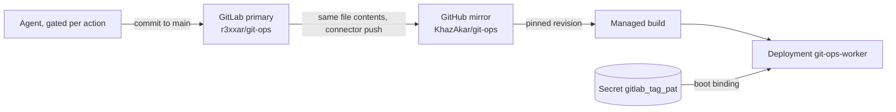

# ADR-2026-11-16-001 - Repo doctrine: GitLab primary, GitHub mirror

## Status

Accepted

## What

The home, flow, and credential doctrine of the git-ops repo: where
commits land, how the mirror stays honest, and how the secret
reaches the deployment.

## When

Now (binding at repo creation).

## Model

## Specification

1. GitLab is the primary. All commits, review, and CI for the
   source happen on `r3xxar/git-ops` `main`.
2. GitHub is a derived mirror at `KhazAkar/git-ops`. It exists
   because managed Mistral deployments build from GitHub; that is
   the one load-bearing reason.
3. Sync is connector dual-write: the same file contents are pushed
   to both hosts by their connectors. Parity is CONTENT parity,
   verified by fetching sample files back from both hosts and
   comparing. SHA parity is impossible and not pursued: the hosts
   compute different SHAs for the same bytes.
4. The mirror never leads. A change that appears only on GitHub is
   a defect; re-push from the primary content.
5. The secret `gitlab_tag_pat` is bound by reference to the
   environment variable `GITLAB_TAG_PAT` in the deployment config.
   The value is never in the repo, in chat, or in a tool call.
   Binding has complete-set semantics: if the secret is missing at
   boot, the deployment fails to serve, loudly.
6. Delivery flow for a change: developer gates the change in chat,
   agent commits to GitLab `main`, agent dual-writes to the GitHub
   mirror, deployment is redeployed pinned to the new revision,
   RECHECK (fetch files back from both, verify identical).

### Verification

- Given both remotes after a sync, when the same file path is
  fetched from each, then the contents are identical.
- Given a deployment config, when it is inspected, then it holds
  the secret NAME `gitlab_tag_pat` and no token value.
- Given a missing secret at boot, when the deployment starts, then
  it fails to serve (binding is not partial).

## Pick

- **GitLab primary + GitHub mirror** - matches the fleet
  namespace (all work repos live on r3xxar GitLab); satisfies the
  managed-build-from-GitHub constraint without moving the canon.
- **Connector dual-write with content parity** - the agent
  environment has no git remote with credentials; connectors are
  the only write path. Content parity is checkable by fetch-back.
- **uv.lock generated developer-side** - the image needs a frozen
  sync; the sandbox that created the repo cannot run uv. One-time
  delegation, recorded in quirks-and-gotchas.
- **Vendored capability references dropped** - the .mdx guide
  files under `.agents/skills/capability-workflows/references/`
  are regenerable with the mistral CLI. SKILL.md and the lint
  scripts stay (the semgrep rules target `scripts/linting/rules`
  by path).

## Drop

- **GitHub-only** - rejected: GitLab is the fleet namespace and the
  review home; GitHub is a build detail, not the canon.
- **True git mirror (git push from a credential holder)** -
  rejected: no credentials exist in the agent environment, and
  adding them to it would weaken the secret story this repo
  exists to build.
- **SHA parity mirroring** - rejected: impossible across hosts
  (different commit objects); content parity is the checkable
  truth.
- **Re-vendoring the capability references** - rejected:
  regenerable docs rot silently; drop them and regenerate on
  demand.
