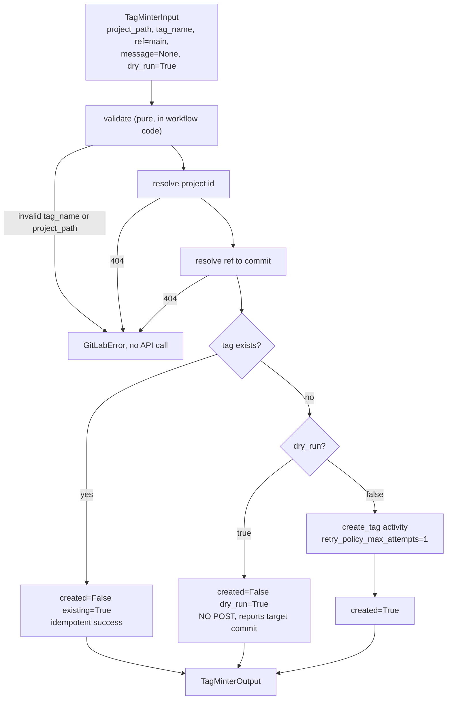

# ADR-2026-11-16-002 - tag_minter workflow specification

## Status

Accepted

## What

The first git-ops workflow: mint a GitLab release tag on a
project, or report that the tag already exists, behind a
dry_run default that makes every unspecified call safe.

## When

Now (the workflow that ships with the repo).

## Model

## Specification

1. Input is ONE Pydantic model, `TagMinterInput`, with the fields
   `project_path`, `tag_name`, `ref` (default "main"), `message`
   (default None), `dry_run` (default True). The type hints are
   the HTTP API schema.
2. Output is `TagMinterOutput`: `tag_name`, `created`, `existing`,
   `dry_run`, `commit_sha`, `web_url`, `detail`. Every branch
   builds the full output; there is no partial success.
3. Validation is pure and deterministic, so it runs directly in
   workflow code: `tag_name` must match `vX.Y.Z`; `project_path`
   must be `namespace/project`. No API call happens before
   validation passes.
4. Each GitLab operation is its own activity: `resolve_project`,
   `get_commit`, `get_tag`, `create_tag`. Read activities keep the
   SDK default retry; `create_tag` sets `retry_policy_max_attempts=1`
   so a write never replays after a partial failure.
5. All network I/O lives in activities. The sync urllib calls run
   through `asyncio.to_thread` so they never block the worker loop.
6. The PAT is read inside each activity from the environment
   variable `GITLAB_TAG_PAT`. It never crosses the workflow
   boundary, never appears in any output, message, or exception.
   A 401 produces a clean rejected-PAT message with no token
   substring.
7. Existing tag is idempotent success: `created=False,
   existing=True`, with the target commit sha and a detail line.
   It is not an error to ask for a tag that exists.
8. `dry_run=True` performs validate + resolve + check, reports
   the target commit ("would create tag on main @ <sha>"), and
   performs NO POST. This is also the christening smoke mode.
9. `dry_run=False` performs the mint. `message` omitted or empty
   makes a lightweight tag; a non-empty `message` makes an
   annotated tag. The POST body carries `tag_name` and `ref`, and
   `message` only when non-empty.
10. `web_url` is built deterministically as the project web_url
    plus `/-/tags/` plus the tag name.

### Verification

- Given a `tag_name` that does not match `vX.Y.Z`, when the
  workflow runs, then it fails with a validation error and no API
  call is made. [unit]
- Given a `project_path` without exactly one slash, when the
  workflow runs, then it fails validation. [unit]
- Given `GITLAB_TAG_PAT` unset, when an activity reads the PAT,
  then it raises the binding hint naming the secret and the
  variable. [unit]
- Given a 401 from GitLab, when the error is raised, then the
  message names the status and never contains the token value.
  [unit]
- Given a project that does not exist, when resolved, then the
  error says project not found. [unit]
- Given a ref that does not exist, when resolved, then the error
  says ref not found. [unit]
- Given a tag that does not exist, when `get_tag` runs, then it
  returns None (404 is not an error). [unit]
- Given a mint, when the POST body is inspected, then it carries
  `tag_name` and `ref`, and `message` only when non-empty, and
  the PRIVATE-TOKEN header is present. [unit]
- Given an existing tag, when the workflow runs, then it returns
  `created=False, existing=True` and posts nothing.
  [deployment]
- Given `dry_run=True` and no existing tag, when the workflow
  runs, then it returns `dry_run=True, created=False` with the
  target commit sha and posts nothing. [deployment]
- Given `dry_run=False` and no existing tag, when the workflow
  runs, then the tag exists on GitLab afterwards and the output
  reports `created=True`. [deployment]

## Pick

- **stdlib urllib + asyncio.to_thread** - the plumbing stays
  importable without any SDK, so unit tests run on a bare
  interpreter; the read path has no retry hazard because reads
  are idempotent.
- **One activity per GitLab operation** - retry scope equals
  operation scope; a failed resolve can retry without replaying
  a create.
- **retry_policy_max_attempts=1 on create_tag** - a write must
  not replay; if the POST outcome is unknown, a human looks.
- **Idempotent exists semantics** - re-running a mint after a
  timeout is safe and truthful; no surprise second tag.
- **PAT read inside each activity** - the credential lifetime
  stays inside one activity call frame; nothing serializable
  ever holds it.

## Drop

- **httpx/async client** - rejected: a dependency that the test
  environment cannot install, for no behavioural gain at this
  call volume.
- **Single-activity whole flow** - rejected: retries would replay
  the whole flow including the POST, and it violates
  one-activity-per-operation.
- **Search-based project resolution v1** - rejected: the search
  API shape is unverified; path lookup is the documented stable
  route.
- **Annotated-tag-always** - rejected: lightweight tags match the
  fleet convention (`git tag vX.Y.Z`), message stays optional.
