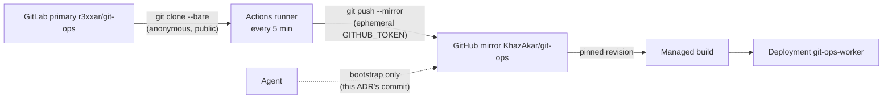

# ADR-2026-11-16-003 - Automated mirror: schedule-driven pull

## Status

Accepted. Supersedes ADR-2026-11-16-001 point 3 (connector
dual-write as the sync mechanism); every other point of
ADR-001 stands.

## What

The GitHub mirror syncs itself. A scheduled GitHub Actions
workflow in the repo clones the GitLab primary and force-pushes
the full ref set to the mirror. Manual connector dual-write
retires to bootstrap-only.

## When

Now.

## Model

## Specification

1. Mechanism: `.github/workflows/mirror.yml`, schedule cron
   `*/5 * * * *` plus manual `workflow_dispatch`. The file lives
   in the GitLab primary; the mirror serves it after one final
   bootstrap dual-write (the commit that lands this ADR).
2. Each run: `git clone --bare` of the primary (anonymous; the
   repo is public), then `git push --mirror` with the in-run
   GITHUB_TOKEN under `permissions: contents: write`. No stored
   secret exists anywhere in this mechanism: the token is
   ephemeral, repo-scoped, and never leaves GitHub. ADR-001's
   rejection of a credential holder is upheld in spirit: the
   agent environment still holds no credentials; the runner
   token is GitHub's own, scoped to this repo and this push.
3. Mirror semantics: bare clone carries `refs/heads/*` and
   `refs/tags/*` only. Pushes are forced; refs the primary
   dropped are deleted on the mirror.
4. Consequence at switchover: mirror history becomes the
   primary history. The GitHub-native bootstrap commits are
   replaced by the primary's SHAs, so SHA parity becomes true
   parity for synced refs, superseding the content-parity-only
   stance of ADR-001 point 3. Deployments pin GitLab-native
   SHAs from the first mirrored revision onward.
5. The mirror still never leads (ADR-001 point 4). The
   workflow is the only sanctioned writer; connector
   `push_files` to the mirror is bootstrap-only, and a change
   that appears only on GitHub remains a defect, to be
   overwritten by the next run.
6. Repo metadata on GitHub (description, settings, branch
   protection) lives outside git; the developer manages it by
   hand.
7. Delivery flow for a change from here: developer gates the
   change in chat, agent commits to GitLab `main`, the mirror
   workflow delivers it to GitHub within 5 minutes, deployment
   is redeployed pinned to the new primary SHA, RECHECK
   (fetch files back from both, verify identical).

### Verification

- Given the workflow on mirror main, when the schedule fires
  (within 5 minutes), then a run completes and the mirror head
  SHA equals the primary head SHA. [deployment]
- Given a new commit on the primary, when the next run
  completes, then the mirror holds that commit under the
  primary's SHA with identical content. [deployment]
- Given a ref on the mirror absent from the primary, when a
  run completes, then the ref is gone from the mirror.
  [deployment]
- Given any run, when the workflow file is inspected, then it
  references no stored secret: the clone is anonymous and the
  only token is the ephemeral GITHUB_TOKEN. [deployment]

## Pick

- **GitHub Actions scheduled pull-mirror** - zero stored
  secrets, lives in-repo on the primary, self-healing (a
  missed or failed run is corrected by the next tick), and
  the token is scoped to contents:write on this one repo.
- **Cron `*/5`** - public repo, free standard minutes, and a
  near-instant no-op when in sync. The only consumer of
  freshness is manual deployment pinning; 5 minutes of
  staleness is acceptable.

## Drop

- **GitLab push mirror (repo settings)** - rejected: requires
  a GitHub PAT with write scope stored in GitLab, a standing
  credential the minimal-credential doctrine refuses.
- **Agent-side scheduled dual-write** - rejected: keeps a
  human or agent in the loop this ADR removes, and connector
  rate limits and transient 502s make it the fragile option.
- **Webhook-triggered dispatch** - rejected: needs a dispatch
  secret stored on GitLab and buys minutes over the `*/5`
  cadence.
